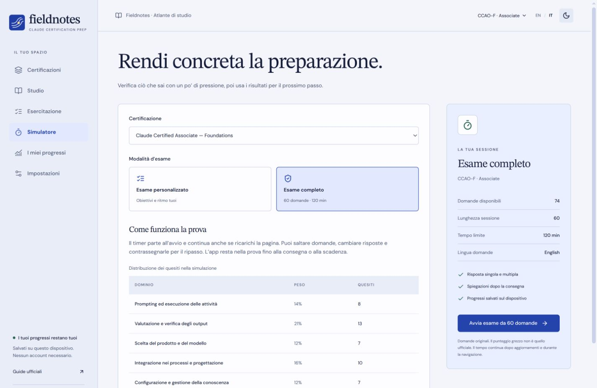

# Fieldnotes — Preparazione alle certificazioni Claude

[](https://github.com/MrSecret35/Anthropic_certipication_prep/actions/workflows/deploy.yml)
[](LICENSE)

Fieldnotes è un’app indipendente per studiare, esercitarsi e simulare l’esame **Claude Certified Associate – Foundations (CCAO-F)**. Offre lezioni in italiano e inglese, **124 domande originali bilingui** e una **simulazione completa da 60 quesiti in 120 minuti** per Associate. È un sito statico: non servono account, API key, backend o servizi a pagamento.

**[Apri Fieldnotes online](https://mrsecret35.github.io/Anthropic_certipication_prep/) · [Vai alla simulazione Associate](https://mrsecret35.github.io/Anthropic_certipication_prep/#/exam?cert=associate-foundations)**

> **Progetto indipendente, non ufficiale.** Non è affiliato ad Anthropic né da essa approvato. I quesiti sono originali, non riproducono domande riservate o reali d’esame. Il punteggio di Fieldnotes non equivale al punteggio scalato ufficiale e non predice il superamento dell’esame.

## Avvio rapido

Requisiti: Node.js **22.12 o successivo** e npm.

```bash
git clone https://github.com/MrSecret35/Anthropic_certipication_prep.git
cd Anthropic_certipication_prep
npm ci
npm run dev
```

Apri l’indirizzo **Local** stampato da Vite. L’app parte in inglese: usa **EN / IT** nella barra superiore per passare all’italiano. Il pulsante accanto cambia tema.

| Comando            | Scopo                                                                |
| ------------------ | -------------------------------------------------------------------- |
| `npm run dev`      | Avvia il server di sviluppo con aggiornamento automatico             |
| `npm run validate` | Controlla traduzioni, risposte, riferimenti e collegamenti ai moduli |
| `npm test`         | Esegue i test del motore, della simulazione e del salvataggio        |
| `npm run build`    | Verifica TypeScript e genera il sito statico in `dist/`              |
| `npm run preview`  | Serve in locale l’ultima build di produzione                         |

## Come usarlo

1. **Studia.** Scegli una certificazione dall’indice. Nella home puoi selezionare uno dei sette punti della mappa Associate per vedere il peso del dominio nell’esame e aprire la lezione. Ogni modulo include una lettura rapida, un approfondimento, termini chiave, esempi e riferimenti. Segna il modulo come completato quando hai finito.
2. **Fai pratica.** Filtra per dominio, modulo, difficoltà o domande mai viste, errate o saltate. Dopo la verifica, vedi il perché di ogni alternativa e puoi tornare alla lezione collegata.
3. **Simula.** Apri **Simulatore → Associate — Foundations → Esame completo**. Il riepilogo mostra durata, lingua e distribuzione dei quesiti prima di iniziare.
4. **Ripassa.** Dopo la consegna trovi il riepilogo per dominio, modulo e difficoltà, le risposte spiegate e un piano di ripasso basato sugli errori. Puoi passare alla traduzione italiana dei quesiti e rifare solo quelli sbagliati.

### Simulazione completa Associate



La prova sceglie **60 domande distinte** da un pool di **74 quesiti a scenario** dedicati alla simulazione. Sono incluse risposte singole e multiple; i quesiti d’esame sono in inglese. La distribuzione applica il metodo dei maggiori resti ai pesi del blueprint:

| Dominio CCAO-F                             | Peso del blueprint | Quesiti nella prova |
| ------------------------------------------ | -----------------: | ------------------: |
| Prompting ed esecuzione delle attività     |                14% |                   8 |
| Valutazione e verifica degli output        |                21% |                  13 |
| Scelta del prodotto e del modello          |                12% |                   7 |
| Integrazione nei processi e progettazione  |                16% |                  10 |
| Configurazione e gestione della conoscenza |                12% |                   7 |
| Governance, rischi e uso responsabile      |                15% |                   9 |
| Diagnosi e ottimizzazione                  |                10% |                   6 |
| **Totale**                                 |           **100%** |              **60** |

- **Timer reale di 120 minuti.** Parte all’avvio e non si mette in pausa. La scadenza, l’ordine delle domande e delle opzioni, le risposte e le segnalazioni restano salvati al refresh. Se chiudi la scheda, il timer continua; alla riapertura un tentativo scaduto viene consegnato automaticamente.
- **Schermata dedicata.** Mappa delle domande, filtri per quelle da completare o segnalate, navigazione libera, modifica e cancellazione della risposta. La consegna anticipata mostra un riepilogo prima di chiedere conferma. La modalità termina con la consegna o allo scadere del tempo.
- **Feedback dopo la consegna.** Le risposte multiple valgono un punto solo se selezioni esattamente tutte le alternative corrette. Una risposta incompleta o assente vale zero. Il risultato è grezzo: corrette diviso 60. Non c’è una soglia ufficiale di promozione nell’app.
- **Varianti, non 74 prove diverse.** I tentativi privilegiano quesiti mai visti o visti meno spesso, poi mescolano domande e opzioni. Con il pool attuale due prove complete condividono necessariamente almeno 46 quesiti. Per stimare la preparazione, dai più peso al primo tentativo e agli errori su scenari nuovi.

Il simulatore replica durata, lunghezza e distribuzione del blueprint; è uno strumento di studio, non una prova sorvegliata o calibrata da Anthropic. Per una sessione più breve scegli **Esame personalizzato**: 10, 20, 30 o 60 domande richieste, filtri e timer opzionale. Se la banca filtrata è più piccola, l’app indica la lunghezza effettiva prima dell’avvio.

## Copertura dei percorsi

| Percorso                          | Moduli | Domande EN/IT | Esame nell’app                     | Riferimento ufficiale                  |
| --------------------------------- | -----: | ------------: | ---------------------------------- | -------------------------------------- |
| Associate — Foundations (CCAO-F)  |      7 |            97 | Completo e personalizzato          | 60 quesiti, 120 min                    |
| Developer — Foundations (CCDV-F)  |      1 |             9 | Personalizzato, contenuti iniziali | 53 quesiti, 120 min                    |
| Architect — Foundations (CCAR-F)  |      1 |             9 | Personalizzato, contenuti iniziali | 60 quesiti, 120 min, scenari collegati |
| Architect — Professional (CCAR-P) |      1 |             9 | Personalizzato, contenuti iniziali | 63 quesiti, 120 min                    |

I blueprint derivano dalle guide Anthropic, **v1.0, luglio 2026**, verificate l’**8 novembre 2026**. I link alle guide sono nelle singole schede di certificazione e in [`content/certifications.ts`](content/certifications.ts). Controlla il [Partner Academy](https://anthropic-partners.skilljar.com/page/partner-certifications) per eventuali aggiornamenti prima di prenotare un esame. Le spiegazioni rimandano a fonti primarie; i PDF ufficiali non sono redistribuiti qui.

Associate copre tutti i domini con lezioni introduttive e laboratori guidati. Gli altri tre percorsi coprono per ora un modulo ciascuno: rispettivamente ciclo degli strumenti, orchestrazione e RAG. Per questi tre percorsi le prove complete restano disabilitate finché mancano quesiti idonei per ciascun dominio. Per Architect Foundations mancano anche i gruppi di domande collegati a uno stesso scenario.

## Progressi e privacy

Preferenze, moduli completati, tentativi e prova in corso sono salvati **in questo browser** con la chiave `fieldnotes-progress-v1`. I contenuti, i font e il codice sono serviti con il sito; non vengono inviati prompt, risposte o analytics a terzi. I link alle fonti aprono siti esterni solo quando li selezioni.

Da **Impostazioni** puoi esportare un backup JSON, importarlo dopo averne controllato il riepilogo o azzerare i dati con conferma. Origini diverse, per esempio `localhost` e GitHub Pages, hanno archivi separati: usa l’export per spostarti. Conserva al massimo 500 sessioni completate; usa una sola scheda per evitare sovrascritture concorrenti. I dati locali sono modificabili da chi controlla il browser: il simulatore non è un sistema di certificazione.

I consigli di ripasso considerano fino a cinque sessioni recenti, difficoltà, peso del dominio ed errori. Mostrano la dimensione del campione; vedere la stessa domanda più volte non dà la stessa evidenza di domande diverse. L’indicatore di preparazione è un suggerimento locale, non una probabilità di superamento.

## Struttura del progetto

```text
content/
  certifications.ts        Blueprint, durate, domini e guide
  modules.json             Lezioni e obiettivi EN/IT
  questions.json           Banca introduttiva
  questions-scenarios.json Quesiti a scenario ed eleggibilità per la prova
src/
  components/              Layout e componenti accessibili
  pages/                   Studio, pratica, simulatore, risultati e impostazioni
  hooks/                   Stato dell’app e scadenza dei tentativi
  lib/engine.ts            Selezione, timer, punteggi e raccomandazioni
  lib/storage.ts           Import e persistenza locale
  lib/validation.ts        Verifica del contenuto
  types/                   Schemi TypeScript
scripts/validate-content.ts
tests/engine.test.ts
.github/workflows/deploy.yml
```

React, TypeScript e Vite generano il sito statico. Le rotte vengono caricate quando servono; la banca a scenario ha un asset separato, riutilizzabile dalla cache. Il tentativo salva lo snapshot degli ID e delle opzioni: ricaricare la pagina non rigenera la prova.

## Pubblicazione su GitHub Pages

Il workflow [Verifica e deploy](.github/workflows/deploy.yml) esegue `npm ci`, validazione, test e build. Le pull request eseguono le verifiche; i push a `main` e gli avvii manuali preparano e pubblicano `dist/`.

Per pubblicare un fork:

1. Nel repository, apri **Settings → Pages → Build and deployment** e seleziona **GitHub Actions** come sorgente.
2. In **Actions**, esegui **Validate and deploy GitHub Pages** (o fai un push a `main`).
3. Apri l’URL del job **deploy** quando termina. Se il deploy fallisce, controlla prima che Pages sia abilitato e che l’ambiente `github-pages` permetta il deploy dal ramo `main`.

Vite usa percorsi relativi (`base: './'`) e React Router usa rotte hash; il sito funziona sotto il percorso del repository e il refresh delle pagine interne non richiede regole lato server.

## Contribuire

Leggi [CONTRIBUTING.md](CONTRIBUTING.md) e [CONTENT_GUIDELINES.md](CONTENT_GUIDELINES.md). Conserva gli ID delle domande e dei moduli già pubblicati, per non perdere lo storico. Una nuova domanda deve avere testo e spiegazioni in entrambe le lingue, riferimenti verificabili e collegamenti agli obiettivi. Per includerla in una prova completa usa `fullExam: true` solo dopo il controllo editoriale indicato nelle linee guida.

Le prossime priorità sono una revisione indipendente dei quesiti Associate, una banca più ampia per ridurre le ripetizioni, e copertura per tutti i domini Developer e Architect. I casi di studio collegati di Architect Foundations richiedono sia nuovi contenuti sia supporto nel motore.

## English quick start

Fieldnotes is an independent English/Italian Claude certification study app. Run `npm ci && npm run dev` with Node.js 22.12+. Open **Exam Simulator → Associate — Foundations → Full Exam** for a 60-question, 120-minute English mock. Explanations and optional Italian translations unlock after submission. The other three tracks have starter study and custom practice. Progress stays in your browser and can be backed up in **Settings**. Use `npm run validate && npm test && npm run build` before contributing.

Codice e contenuti didattici originali: [licenza MIT](LICENSE). Font, documenti citati e marchi mantengono licenze e titolari rispettivi.
