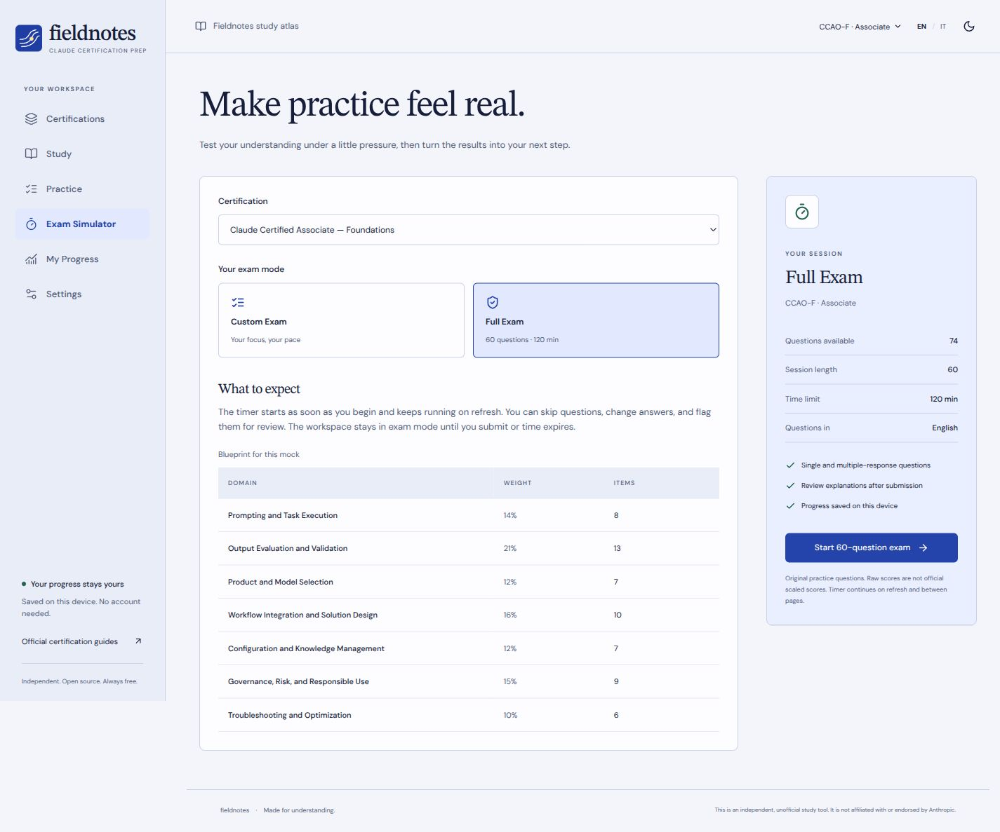

# Fieldnotes — Claude Certification Prep

[](https://github.com/MrSecret35/Anthropic_certipication_prep/actions/workflows/deploy.yml)
[](LICENSE)

Fieldnotes is an independent study app for Claude certifications. It offers lessons in English and Italian, **124 original bilingual questions**, and a **60-question, 120-minute mock exam** for **Claude Certified Associate — Foundations (CCAO-F)**. The app runs as a free static site and requires no account, API key, or backend.

**[Open Fieldnotes](https://mrsecret35.github.io/Anthropic_certipication_prep/) · [Go to the Associate mock exam](https://mrsecret35.github.io/Anthropic_certipication_prep/#/exam?cert=associate-foundations)**

> **Independent study project.** Fieldnotes has no affiliation with or endorsement from Anthropic. The question bank contains original practice items. Fieldnotes reports raw scores for study feedback. Anthropic uses its own scoring scale.

## Quick start

Use Node.js **22.12 or later** and npm.

```bash
git clone https://github.com/MrSecret35/Anthropic_certipication_prep.git
cd Anthropic_certipication_prep
npm ci
npm run dev
```

Open the **Local** URL printed by Vite. The app starts in English. Use **EN / IT** in the top bar to switch languages and the adjacent button to change the theme.

| Command            | Purpose                                                              |
| ------------------ | -------------------------------------------------------------------- |
| `npm run dev`      | Starts the development server with live reload                       |
| `npm run validate` | Checks translations, answers, references, and links to study modules |
| `npm test`         | Tests the exam engine, simulation, and progress storage              |
| `npm run build`    | Checks TypeScript and builds the static site in `dist/`              |
| `npm run preview`  | Serves the latest production build locally                           |

## How to study

1. **Study.** Choose a certification from the index. On the home page, select any of the seven points on the Associate chart to see the domain’s exam weight and open its lesson. Each module has a quick read, a deep dive, key terms, examples, and references. Mark the module complete when you finish.
2. **Practice.** Filter by domain, module, difficulty, or questions you haven’t seen, answered incorrectly, or skipped. After checking an answer, read the explanation for each option and revisit the linked lesson.
3. **Take a mock exam.** Open **Exam Simulator → Associate — Foundations → Full Exam**. The setup screen shows the time limit, question language, and distribution across domains.
4. **Review.** After submitting, see your results by domain, module, and difficulty, along with answer explanations and a study plan based on your mistakes. You can switch to the Italian translation of the questions and retry the ones you missed.

### Full Associate mock exam



The simulator draws **60 distinct questions** from a pool of **74 scenario-based items** eligible for the full exam. Questions are in English and include both single- and multiple-response formats. The largest remainder method converts the blueprint weights into whole question counts.

| CCAO-F domain                            | Blueprint weight | Questions per exam |
| ---------------------------------------- | ---------------: | -----------------: |
| Prompting and Task Execution             |              14% |                  8 |
| Output Evaluation and Validation         |              21% |                 13 |
| Product and Model Selection              |              12% |                  7 |
| Workflow Integration and Solution Design |              16% |                 10 |
| Configuration and Knowledge Management   |              12% |                  7 |
| Governance, Risk, and Responsible Use    |              15% |                  9 |
| Troubleshooting and Optimization         |              10% |                  6 |
| **Total**                                |         **100%** |             **60** |

- **120-minute countdown.** The timer starts when you begin and keeps running if you refresh or close the tab. The deadline, question and option order, answers, and review flags are saved. Reopening an expired attempt submits it automatically.
- **Dedicated exam view.** Use the question map to jump between questions or filter for unanswered and flagged items. You can change or clear answers until you submit or time runs out. If you submit early, a summary appears before confirmation.
- **Feedback after submission.** A multiple-response question earns one point only if you select every correct option and no incorrect options. Incomplete and unanswered questions earn zero. The raw score is the number correct out of 60. The app does not apply an official passing threshold.
- **Question overlap between attempts.** The simulator prioritizes questions you have seen least often, then shuffles questions and options. With the current pool, any two full attempts share at least 46 questions. Give more weight to your first attempt and to mistakes on scenarios you haven’t seen before.

The mock is a self-administered study tool that follows the blueprint’s length, time limit, and domain weights. In **Custom Exam**, you can request 10, 20, 30, or 60 questions, apply filters, and optionally set a timer. If fewer questions match, the app shows the actual count before you start.

## Certification coverage

| Track                             | Modules | EN/IT questions | In-app exam modes                 | Official exam format                  |
| --------------------------------- | ------: | --------------: | --------------------------------- | ------------------------------------- |
| Associate — Foundations (CCAO-F)  |       7 |              97 | Full and custom exams             | 60 questions, 120 min                 |
| Developer — Foundations (CCDV-F)  |       1 |               9 | Custom exam with starter content  | 53 questions, 120 min                 |
| Architect — Foundations (CCAR-F)  |       1 |               9 | Custom exam with starter content  | 60 questions, 120 min, linked cases   |
| Architect — Professional (CCAR-P) |       1 |               9 | Custom exam with starter content  | 63 questions, 120 min                 |

The blueprints use Anthropic’s **v1.0 guides from July 2026**, verified on **November 8, 2026**. Each certification page links to its guide, as does [`content/certifications.ts`](content/certifications.ts). Explanations cite primary sources, and the official PDFs are hosted by the publisher. Check for updates before booking an exam. [Anthropic Partner Academy](https://anthropic-partners.skilljar.com/page/partner-certifications)

Associate covers all seven domains with introductory lessons and guided exercises. The other tracks each cover one topic so far. Developer Foundations covers the tool-use loop, Architect Foundations covers orchestration, and Architect Professional covers retrieval-augmented generation (RAG). Full exams for these tracks need eligible questions across all domains. Architect Foundations also needs groups of questions that share a case study.

## Progress and privacy

Fieldnotes saves your preferences, completed modules, past attempts, and active exam **in your browser** under the `fieldnotes-progress-v1` key. The site serves its own content, fonts, and code and sends no prompts, answers, or analytics to third parties. Source links open external sites when you select them.

In **Settings**, you can export a JSON backup, preview a backup before importing it, or confirm a reset. Browser storage is separate for each origin, such as `localhost` and GitHub Pages. Export a backup to transfer progress. Fieldnotes retains up to 500 completed sessions. Use a single tab to avoid overwriting concurrent changes. Anyone with access to your browser can modify local data.

Review recommendations weigh mistakes, difficulty, and domain importance across up to five recent sessions. The app shows how many questions inform the recommendation. Repeated attempts on the same question give less information than attempts on distinct questions. The readiness indicator is for planning your study.

## Project structure

```text
content/
  certifications.ts        Exam blueprints, time limits, domains, and guides
  modules.json             Lessons and learning objectives in English and Italian
  questions.json           Introductory question bank
  questions-scenarios.json Scenario questions and full exam eligibility
src/
  components/              Layout and accessible components
  pages/                   Study, practice, simulator, results, and settings
  hooks/                   App state and exam deadlines
  lib/engine.ts            Question selection, timing, scoring, and recommendations
  lib/storage.ts           Import and local storage
  lib/validation.ts        Content validation
  types/                   TypeScript schemas
scripts/validate-content.ts
tests/engine.test.ts
.github/workflows/deploy.yml
```

React, TypeScript, and Vite build the static site. Routes load on demand, and the scenario bank is cached as a separate asset. Each attempt stores its question IDs and option order so refreshing keeps the same exam.

## Deploy to GitHub Pages

The [Validate and deploy GitHub Pages workflow](.github/workflows/deploy.yml) runs `npm ci`, content validation, tests, and the production build. Pull requests run the checks. Pushes to `main` and manual workflow runs build and publish `dist/`.

To publish a fork, follow these steps.

1. In your repository, open **Settings → Pages → Build and deployment** and select **GitHub Actions** as the source.
2. In **Actions**, run **Validate and deploy GitHub Pages** or push to `main`.
3. Open the URL from the completed **deploy** job. If deployment fails, check that Pages is enabled and the `github-pages` environment allows deployments from `main`.

Vite uses relative paths (`base: './'`) and React Router uses hash routes. This lets the app run under a repository path and reload on any route without server-side rewrites.

## Contributing

See the [contribution guide](CONTRIBUTING.md) and [content guidelines](CONTENT_GUIDELINES.md). Keep existing question and module IDs to preserve study history. New questions need prompts and explanations in both languages, verifiable references, and links to learning objectives. Set `fullExam: true` only after completing the editorial review described in the guidelines.

Current priorities are an independent review of the Associate questions, a larger pool to reduce repetition, and full domain coverage for the Developer and Architect tracks. Linked case studies for Architect Foundations need both new content and support in the exam engine.

The code and original study content are released under the [MIT License](LICENSE). Fonts, cited documents, and trademarks are subject to their respective licenses and ownership.
